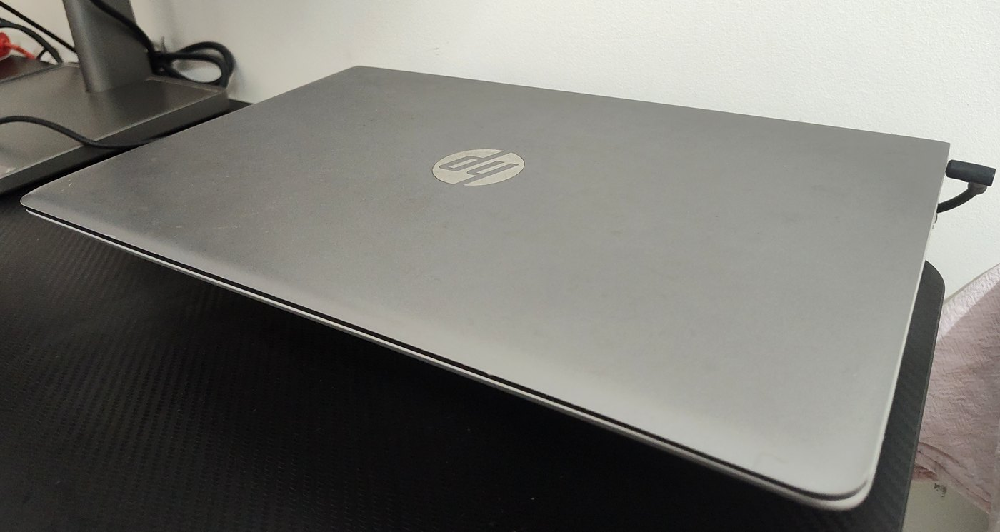
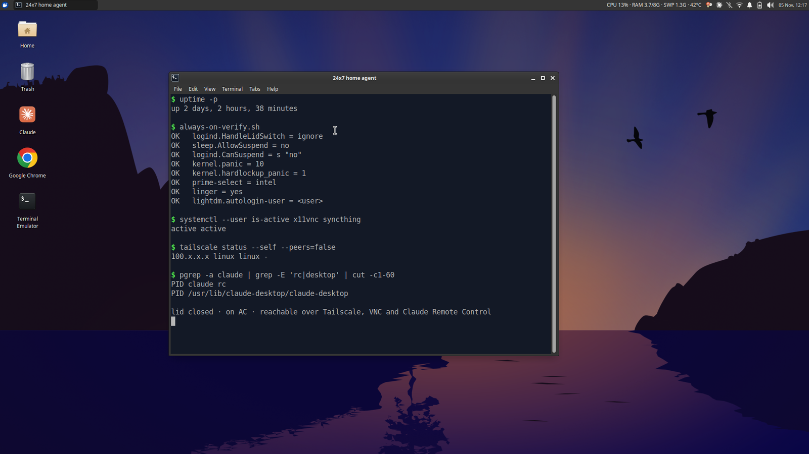
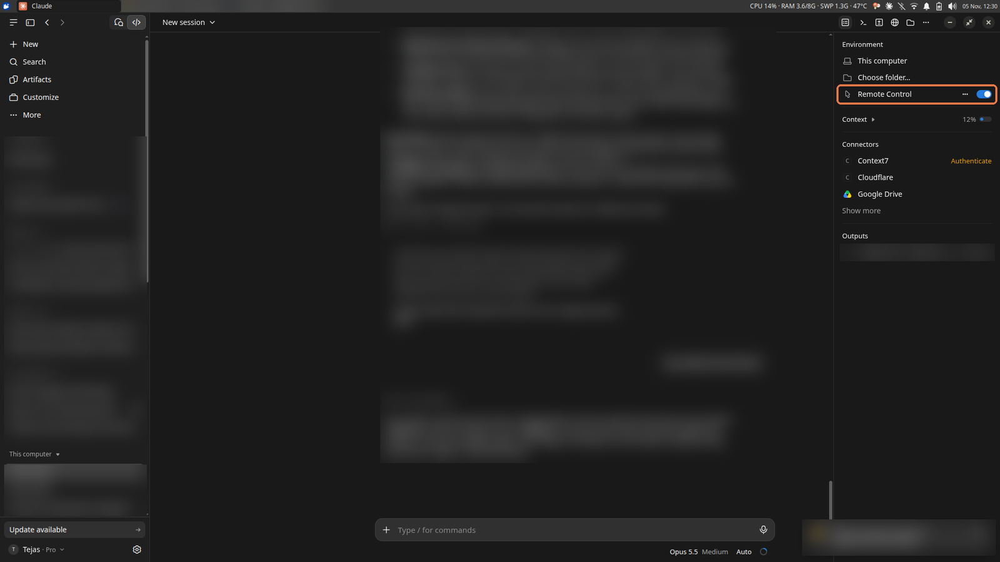
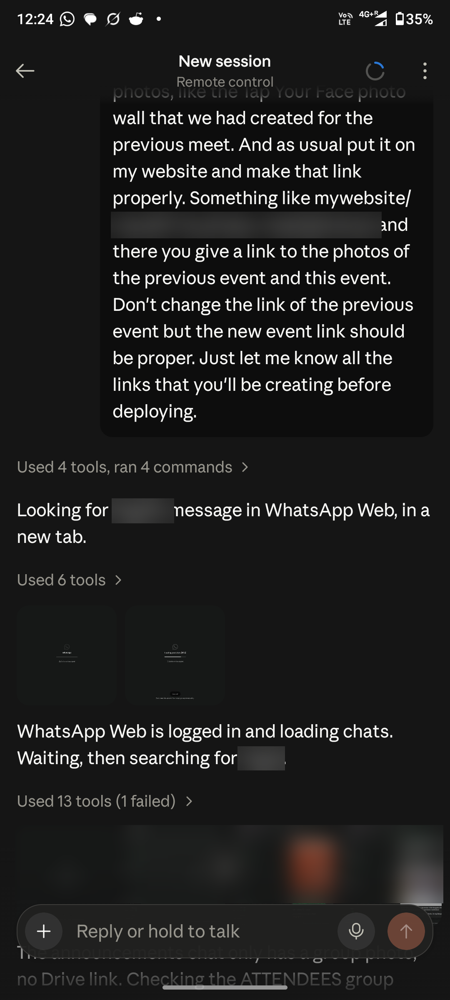
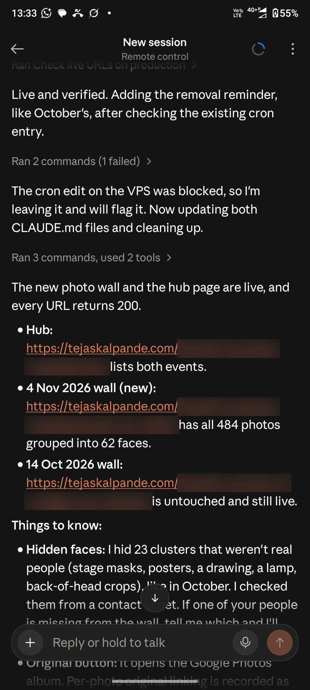

# 24x7 home agent setup

Turn an old laptop or PC into an always-on Claude Code machine you can use from anywhere.

  
  

  

The real machine: lid closed on the desk, its live desktop seen over VNC, and a Claude Code session in the Claude desktop app with Remote Control on (highlighted, private content blurred).

Based on a real build (HP laptop, Xubuntu 26.04 LTS, Nov 2026).

**What you get:** an old laptop or PC that becomes an always-on "do anything" machine. It runs 24/7, plugged in with the lid closed, and you can reach it from anywhere in the world on your phone or any other device. It never sleeps and comes back by itself after a reboot.

## Why not just rent a cheap VPS?

A VPS is cheap and reliable, but there are things it can't do:

- **It has a datacenter IP, and lots of sites block those.** Social media, e-commerce, airlines and banks often block or challenge traffic from cloud servers, or flag the account. A machine at home uses your **residential IP**, so anything you can do on your own home laptop works here too: social media, flight check-ins, shopping, logged-in dashboards.
- **It has no screen.** A VPS is headless. This machine runs a full Ubuntu desktop, so an agent can:
  - use a real, visible browser: Claude's in-app browser, or your own Chrome through Claude in Chrome, with your logins and cookies
  - drive any desktop app with computer use (mouse, keyboard, screenshots), not just the terminal
- **The hardware is probably free.** Most people have an old laptop or PC gathering dust. This puts it to work.
- **You can use it from anywhere, any time.** From your phone, in a cab or on another continent, you can:
  - hand Claude Code a task with Remote Control: write code and run tests, automate a browser, manage social media, update your notes and to-do list
  - SSH into your servers and fix things
  - open VNC when you want to see the screen yourself

A VPS still wins for public-facing services and guaranteed uptime: home power, Wi-Fi and laptop hardware fail more often than a datacenter. Use both if you need both.

## Example: a live deploy, driven from my phone

On 6 Nov 2026 I used this machine from my phone to build a photo wall for an event and put it live on my website. The work ran in a Claude Code session in the Claude desktop app on the machine, with Remote Control on. I sent it three short messages from the Claude app on my phone. In short:

1. A friend sent the event photo link on WhatsApp. Make a photo wall like last time, put it on my site, and show me the new links before you deploy.
2. Yes, it's Google Photos. Go ahead.
3. The links are fine. Deploy when done.

In between, the session:

- opened WhatsApp Web in my signed-in Chrome (through Claude in Chrome) and found the album link in the chat
- downloaded the 484 photos and grouped them by face on the machine itself
- hid 23 groups that weren't people (stage masks, posters, a lamp)
- previewed the built pages in the desktop app's in-app browser
- copied the site to my web server and checked that every new URL returned 200

The first message went out at 12:13 and the wall was live by 13:33 (IST). One step failed: an edit to the server's crontab was blocked, so the session left it and told me.

The first step is the one a VPS does badly: WhatsApp Web and my Chrome logins live on this machine, behind a home IP.

  
  

The session as seen on my phone: my request and the agent opening WhatsApp Web to find the link (left), then live and verified (right). Names, site paths and chat previews blurred.

**How to use this guide:** give the whole file to your agent (Claude Code on that machine) and say "set this machine up following this guide". The steps say *what* to do and in *what order*. The agent works out the commands.

---

## For the agent: read this first

- Work through the steps in order. Check each one before moving on, and report what you did and what failed.
- **You will need the owner for a few things.** Collect them up front:
  - the `sudo` password, entered by the owner, never pasted into chat
  - logging in to the Tailscale, Claude, Google and GitHub accounts in a browser
  - choosing a VNC password (the owner types it themselves)
  - the public SSH keys of the owner's phone and computer
- **Root-level changes:** put them in one script, show it to the owner, and have the owner run it from a terminal on the desktop. Make each change a new drop-in file under `/etc/...` rather than editing packaged config files, so it's easy to undo.
- **Everything else:** install it in user space (`~/.local`) without sudo.
- **Reference scripts** from the original build are in [`scripts/`](scripts/): the always-on settings, a read-only verify script, an undo script, an x11vnc unit and a Claude RC autostart entry. Read and adapt them; don't run them blind.
- Before you finish, run the checks in section 8 and read the gotchas section. Every gotcha there actually happened.

---

## 0. Getting Xubuntu onto the machine (the easy way)
Skip this if Xubuntu 26.04 is already installed.

You don't need to know how to install Linux. Install Claude Code on whatever the machine runs now (Windows or an old Linux) and tell it: "I want to install Xubuntu 26.04 LTS on this laptop. Check the specs and walk me through it step by step." It checks the hardware, disks and what's safe to keep, then walks you through the backup, cleanup, USB installer and install.

That's how this machine was built: Claude Code running on an old Ubuntu 18.04 install did the cleanup and guided the Xubuntu install. Once Xubuntu is running, install Claude Code again and give it this guide.

## 1. Base OS
1. Install Xubuntu 26.04 LTS. Use the default **X11** session, not Wayland: VNC mirroring and xdotool need X11.
2. Connect Wi-Fi as a **system-wide** connection, with the password saved for all users. It must connect at boot, before anyone logs in. Ethernet is better if you can run a cable.
3. Install all updates. Keep unattended-upgrades on, with automatic reboot off.
4. On a laptop with both Intel and NVIDIA graphics: switch to **Intel-only** (PRIME, `sudo prime-select intel`), then reboot. Why: a 24/7 box with no monitor has no use for the NVIDIA card, but in on-demand mode an older one (here a 940MX) never powers down, so it adds heat and power draw for nothing. The NVIDIA driver also sat in the display path when this machine froze at display standby (see Gotchas). Removing it took out one likely cause. Skip this if NVIDIA is your only GPU, or if you want the card for local AI models.

## 2. Remote access
5. **Tailscale:** install it, log in, give the machine a short name, and **turn off key expiry** for it in the Tailscale admin console. Install Tailscale on your phone and computer too.
6. **OpenSSH server:** key-only login, no root login, and logins allowed only from Tailscale addresses and the home network. Add the owner's public keys.

## 3. Always-on settings (do all of them, then reboot)
7. **Lid:** set the lid switch to "ignore" in logind (on AC, on battery and docked). **Also** set XFCE Power Manager's lid action to "switch off display" for both AC and battery.
8. **Sleep:** turn off every sleep mode in systemd (suspend, hibernate, hybrid sleep, suspend-then-hibernate). Set idle action to ignore and the XFCE system-sleep timers to never.
9. **Low battery** (during a power cut): XFCE shuts the machine down cleanly at about 20%, with UPower doing the same at 15% as a backstop. Don't use hibernate or hybrid sleep.
10. **Wi-Fi power saving:** off.
11. **Automatic recovery from freezes:**
    - Reboot 10 seconds after a kernel panic.
    - Turn soft lockups, hard lockups and hung tasks into panics, so a freeze ends in a reboot.
    - Keep pstore enabled so the crash log survives the reboot.
12. **Linger:** turn it on for the user, so the user's background services start at boot without anyone logging in.
13. **Login without a password:** set LightDM to log the user straight into the Xubuntu session.
14. **Keyring without a password:** set the GNOME login keyring's password to **blank**. Automatic login doesn't unlock the keyring, so otherwise the Claude app, Chrome and `gh` stop at a password prompt after every reboot.
15. **Screen lock:** leave it on. It doesn't make the machine sleep, and with automatic login it's the only thing protecting the desktop. Unlock it over VNC with the login password.

## 4. Remote desktop (VNC)
16. **x11vnc** mirrors the real desktop (display `:0`). Run it as a **user systemd service** that restarts on failure. Protect it with a VNC password, and make it listen **only on the machine's Tailscale addresses** (IPv4 and IPv6).
17. To connect, use macOS Screen Sharing, or AVNC or RealVNC Viewer on Android, pointed at the machine's Tailscale IP.

## 5. Browser and desktop control
18. **Google Chrome:** signed in, with the **Claude in Chrome** extension. Add Firefox if you want it.
19. **xdotool** is the computer-use tool: it moves the mouse, clicks, types and switches windows. **ffmpeg** takes screenshots of the desktop (x11grab).

## 6. Agent tools (user space; no sudo where possible)
20. From apt: git, `gh` (log in over HTTPS), jq, python3-venv.
21. **uv**, then **Node LTS** from the official tarball, unpacked into `~/.local`, with npm's global install folder also set to `~/.local`. Then bun and anything else the owner uses (wrangler, yt-dlp and so on).
22. **Claude Code CLI** (native installer). Log in, and restore `~/.claude` (settings, skills, hooks, memory) if the owner has a backup.
23. **Claude desktop app** (Anthropic's official `.deb`). Log in.
24. Optional: Syncthing as a user service, for syncing notes or a vault.

## 7. What starts at boot
| What | How it starts |
|---|---|
| Tailscale | system service |
| SSH | system socket activation |
| x11vnc | user systemd service (needs the auto-login desktop) |
| Syncthing (optional) | user systemd service |
| Claude desktop app | XFCE autostart entry |
| Google Chrome | XFCE autostart entry |
| **Claude RC** (`claude rc`, remote control) | XFCE autostart entry that opens a terminal window running `claude rc` |

Claude RC is what lets you start and drive Claude Code sessions on this machine from the Claude app on your phone or the web. A normal terminal window on the desktop is enough: the desktop is always logged in and never sleeps, so you don't need tmux or any other persistent terminal.

### Claude RC sessions vs desktop app sessions
**Sessions started through `claude rc` can't use the desktop app's in-app browser.** That covers any session you start from your phone or another device in the folder where the `claude rc` terminal is running. Only Claude Code sessions started inside the Claude desktop app get its in-app browser.

So I use both:

- **For browser work:** I start two or three Claude Code sessions in the Claude desktop app on this machine and turn on **Remote Control** for each one (the toggle in the session's side panel, shown in the screenshot at the top). They then show up in the Claude app on my phone and on any other device, and I use them interchangeably for anything that needs the browser.
- **For everything else:** I start a new session from my phone (or any device) in the folder where `claude rc` is running.

### Reboots and power loss
- **Reboot:** no problem. The machine logs itself in, and Tailscale, SSH, VNC, the Claude app, Chrome and Claude RC all come back on their own. If something didn't start or you need anything else, VNC in and start it from the desktop.
- **Full shutdown or power loss:** this is the only case that needs a person.
  - **Laptop:** it rides out short power cuts on its battery. After a long one it shuts down cleanly and stays off until someone presses the power button.
  - **Desktop PC:** look in the BIOS/UEFI for a "Restore on AC power loss" (or "power on after power failure") setting and set it to **On**. The PC then boots by itself when power returns, and auto-login takes it from there.

## 8. Checks
25. Run `systemctl suspend`. It must be refused.
26. Keep an SSH ping running, close the lid and wait 5 minutes. The ping must not drop.
27. Reboot with the lid closed. Within about 2 minutes you should have:
    - SSH back
    - VNC showing the desktop with no login screen
    - the Claude app, Chrome and Claude RC running
    - no keyring prompt
28. Leave it idle with the lid closed for several hours, then check it's still reachable.

---

## Gotchas we hit
- **Lid:** setting the lid in logind alone does nothing. While the desktop is logged in, XFCE Power Manager takes over the lid, and its default is to lock the screen. Set both.
- **logind:** reload it after a config change; don't restart it. A restart can kill the desktop session.
- **Wi-Fi power saving:** the change only takes effect after a reconnect or reboot.
- **Freeze when the display turns off:** the machine froze after about 20 minutes idle, at the display-standby step, on an NVIDIA Optimus laptop. Intel-only graphics plus the freeze-to-reboot settings in step 11 fixed it. Without those settings a freeze leaves the machine stuck until someone pulls the power.
- **Computer Use on Linux:** the Claude desktop app's built-in Computer Use is switched off on Linux from Anthropic's side, and its setting is hidden. Use xdotool instead.
- **xdotool and focus:** xdotool types into whichever window has focus, usually the Claude app. Always switch to the target window first, then switch back to Claude afterwards. It doesn't work on Wayland or at the login screen.
- **x11vnc and IPv6:** by default x11vnc listens on every IPv6 address. `-noipv6` didn't stop it; only `-listenv6 <tailscale-ipv6>` did. Check which addresses it listens on after every flag change.
- **VNC password:** only the first 8 characters count.
- **VNC after a reboot:** x11vnc needs a logged-in desktop. Without automatic login it has nothing to show.
- **Keyring:** it stays locked after automatic login unless its password is blank. The trade-off is that saved secrets sit unencrypted on disk, so use full-disk encryption or keep the machine somewhere you trust.
- **PATH over SSH:** a one-off `ssh host cmd` doesn't load `~/.local/bin`, so node, claude and uv look missing. Use a login shell (`bash -lc`).
- **Plugin marketplaces:** `claude plugin marketplace add owner/repo` clones over SSH and fails without a GitHub SSH key. Use the full `https://github.com/...git` URL.
- **Tailscale ping:** a failed `tailscale ping` doesn't mean the machine is down (relayed connections can time out while SSH still works), so test with SSH.
- **Tailscale key expiry:** an expired key locks you out completely, which is why step 5 turns expiry off.
- **No inbound ports at home:** a home connection may be behind carrier-grade NAT, so don't rely on opening ports. Use Tailscale, or a Cloudflare Tunnel for anything public.
- **Closing the Claude RC window stops Claude RC.** Start it again over VNC.

## Hardware caveats
- **Battery charge limit:** many consumer laptops can't cap charging at 80%. The battery then sits at 100% around the clock; watch for swelling.
- **Placement:** put it on a hard surface or a stand with the vents clear. Check the CPU temperature an hour after closing the lid. Sustained readings above 85 °C mean it needs better airflow.

## Optional: reach the desktop from any browser, without Tailscale
For when you don't have your phone or laptop: a borrowed computer or a hotel PC. Put a **browser-based VNC gateway with its own login** on the machine, for example Apache Guacamole (username, password and two-factor codes), and publish it on a public HTTPS URL:
- **No domain needed: Tailscale Funnel.** It publishes a local port at `https://<machine>.<your-tailnet>.ts.net`, on every Tailscale plan, including free. Funnel itself has **no login**: anyone who has the URL reaches the page. So the gateway's own login (with 2FA turned on) is the only thing standing between the internet and your desktop.
- **With your own domain: Cloudflare Tunnel plus Cloudflare Access.** For example `desk.yourdomain.com`. Cloudflare checks your email login before any traffic reaches the machine, and then the VNC password applies, so there are two locks. This is the safer option.

Either way your whole desktop is on the public internet. Keep x11vnc itself bound to Tailscale or localhost, and expose only the gateway.

## Nice to have
- A firewall that allows only the Tailscale interface and the home network.
- Ethernet instead of Wi-Fi.
- A dead-man alert: another machine messages you if this one goes offline.

## License
[MIT](LICENSE)
